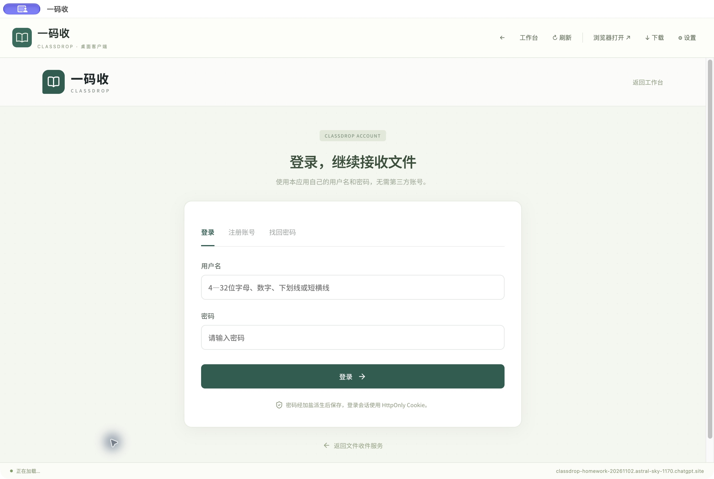

# 一码收 · ClassDrop

通过二维码接收作业、打印资料和日常文件的桌面应用。提交者不需要安装软件，收件人在电脑客户端管理、下载文件。

**桌面客户端需要网络和兼容的云端服务。** 本仓库包含客户端与配套 Web 服务源码，不是离线文件服务器。默认连接当前试用服务，也可在设置中填写自己的兼容服务地址。



## 下载安装

到 [Releases](https://github.com/2395300049-sys/classdrop/releases) 下载安装包：

- Mac Apple Silicon：文件名包含 `mac-arm64`。
- Mac Intel：文件名包含 `mac-x64`。
- Windows：下载 `win-x64.exe` 安装包。
- Linux：下载 `linux-x86_64.AppImage`。

只有实际出现在 Release 附件列表中的安装包才已构建完成。

当前为 **0.1.0 试用版**。Mac 包采用 ad-hoc 本地签名，尚未完成 Apple Developer ID 签名和公证；Windows 包尚未购买代码签名证书，系统可能显示发布者验证提示。

## 能做什么

- 创建通用文件、作业、打印店三种收件入口，分享对应二维码。
- 文件按首次收件日期归档；查看最近更新和到期时间。
- 新上传文件默认保存30天，支持搜索、日期筛选、CSV 和 ZIP 导出。
- 回收站恢复、打印要求与处理状态、收件入口设置。
- 桌面原生保存对话框、最近下载记录、显示本地文件、断网重连。
- 配置 HTTPS 服务地址，登录状态在本机持久保存。

管理端使用本应用自己的用户名和密码登录，不依赖 ChatGPT、微信或其他第三方账号。注册时会生成恢复密钥，请在首次使用时妥善保存；忘记密码可用它重新设置。

**桌面版本不会解除微信对现有网址的访问限制。** 向班群或顾客提供二维码之前，应在真实手机和实际网络测试。

## 源码结构

```text
desktop/       Electron 主进程、隔离界面、图标、策略测试
web/           配套 Workers / D1 / R2 服务源码
.github/       检查与跨平台安装包工作流
docs/          云端部署边界、发布说明和安全说明
```

仓库不包含上传文件、本地数据库、浏览器登录数据、部署密钥或现有服务的私有发布历史。

## 本地运行与打包

安装 Node.js 22.13 或更新的22版本：

```sh
npm ci
npm test
npm start
```

打包本机平台：

```sh
npm run dist:mac    # macOS
npm run dist:win    # Windows，建议在 Windows 构建
npm run dist:linux  # Linux
```

GitHub Actions 在推送 `v*` 标签时构建 Mac arm64/x64、Windows x64、Linux x64，并将成功的整套产物和校验和发布为预发行版本。也可以通过 Actions 的 `Desktop installers` 手动触发只构建、不发布的工作流。

配套服务见 [云端服务说明](docs/backend.md)；桌面边界见 [安全设计](docs/security.md)。

## 许可

原创代码采用 MIT 许可。源码中保留了所用模板和样式的原始许可证，见 [第三方说明](docs/third-party.md)。
